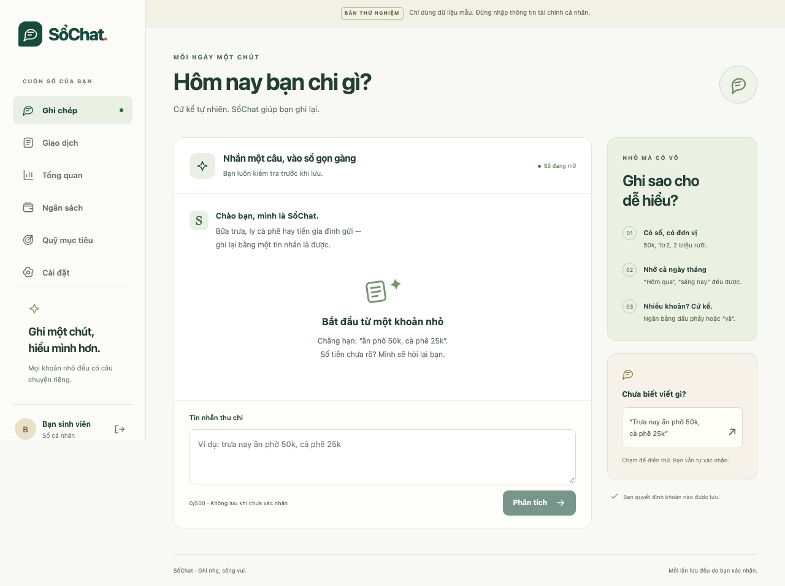
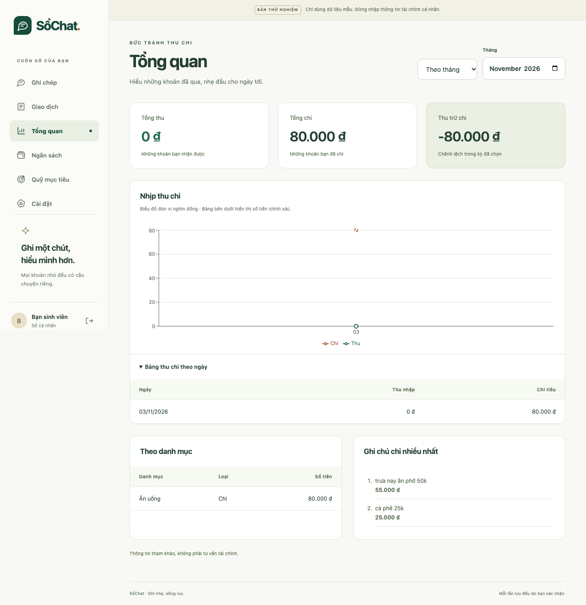
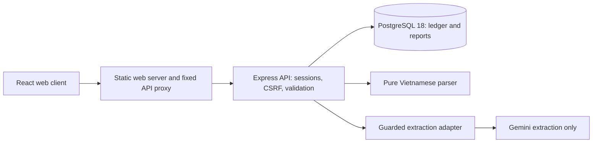
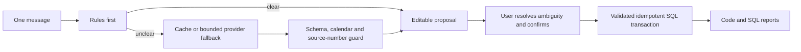

# SổChat

A Vietnamese chat-to-ledger expense tracker for university students.

Status: **Pre-deploy AI and UX expansion**. Playful 2D UI, grouped VND inputs, clearer auth and real Gemini provenance are implemented locally. Public deployment and real-user validation remain owner-gated Phase 8.
See [verification evidence](docs/EVIDENCE.md) for actual checks and limitations.

The MVP supports authentication, chat extraction with editable confirmation,
transaction management, month/year reports, monthly category budgets, simple savings
goals, CSV export and account deletion. OCR, bank linking, investment/tax features,
multi-currency and AI financial advice are outside the MVP.

## Local setup

Use Node.js **22.23.4** and npm **10.9.4**. With nvm installed:

```sh
nvm install
nvm use
npm install --global npm@10.9.4
npm ci
npm run lint
npm run typecheck
npm test
```

Other version managers can read `.node-version`. `.npmrc` rejects incompatible
engines; the install hook also checks Node 22.19+ within major 22. No system Node
installation is changed by this repository.

Optional commands:

```sh
npm run check:runtime
npm run test:coverage
npm run format
cp .env.example .env
```

Parser/evaluation commands do not load `.env` or call Gemini. Database migrations load `.env`; integration tests require Docker and use isolated PostgreSQL 18.
Never commit API keys or real personal/financial data. CI uses deterministic
providers/transport; separately labeled owner-authorized local checks use real Gemini.

## Workspace

| Path              | Responsibility                                  | Implementation phase |
| ----------------- | ----------------------------------------------- | -------------------- |
| `packages/parser` | Pure deterministic Vietnamese parser            | 1                    |
| `apps/api`        | Express 5 + TypeScript API, PostgreSQL via `pg` | 4 (database in 2)    |
| `apps/web`        | React + Vite dashboard, Vietnamese UI           | 5                    |
| `scripts`         | Toolchain validation                            | 0                    |
| `docs/agent`      | Owner-approved scope and phase references       | Reference            |

The API starts from apps/api/src/server.ts; React starts from apps/web/src/main.tsx.
Root lint and typecheck commands cover all three workspaces. Root Vitest discovers
tests under `scripts`, `packages`, `eval` and `apps`. Coverage measures the runtime
guard, parser and evaluation harness. Integration coverage separately measures
database and HTTP code. Browser JS execution-range coverage is recorded separately; it is not TypeScript line coverage.

See [API setup and client flow](docs/API.md). With the local PostgreSQL 18 database
and ignored `.env` configured:

```sh
npm run db:migrate
LLM_PROVIDER=fake npm run api:start
```

The API listens at `http://127.0.0.1:3000`; `/healthz` and `/openapi.json` are public.
The generated [OpenAPI contract](apps/api/openapi.json) documents the endpoints.

## Parser and evaluation

```sh
npm run eval
# Explicit equivalent (rules only, dev only):
npm run eval -- --config rules --split dev
```

The pure TypeScript API is `parseMessage(message, nowIso): ParseResult`. It uses
injected time, exact bigint money normalization, structured flags and Vietnamese
clarification questions. Invalid amounts and dates stay unresolved. See the
[parser contract](docs/PARSER.md) and [evaluation guide](eval/README.md).

Reports are written to `eval/results/rules-dev.json` and `rules-dev.md`. The supplied
65 synthetic dev cases were written by the same developer as the reference rules;
their score is **not representative of real users**. Results and limitations are
recorded in [EVIDENCE](docs/EVIDENCE.md). Held-out evaluation requires the owner's
explicit request and is never part of unit tests or CI.

## Engineering boundaries

- Rules first; Gemini extracts transaction fields, typed question filters and unsaved edit plans.
- Optional consented Gemini embeddings support bounded semantic/keyword retrieval.
- All calculations and business logic run in code/SQL.
- Integer VND, PostgreSQL `bigint`, calendar dates in `Asia/Ho_Chi_Minh` and injected time.
- Parsing proposes transactions; saving always requires user confirmation.
- No real LLM calls in CI; no held-out evaluation without the owner's request.
- Metrics in the supplied kit are authoring-environment references, not results for this repo.

The implementation follows [the charter](docs/agent/PROJECT_CHARTER.md),
[phase instructions](docs/agent/AGENT_PROMPT.md) and
[reference snippets](docs/agent/REFERENCE_SNIPPETS.md). References must be adapted and
tested. [Architecture decisions](docs/DECISIONS.md) record the initial choices;
[the backlog](docs/BACKLOG.md) records deferred questions. Each phase stops at its gate.

License: **not selected**. `UNLICENSED` reserves rights until the owner decides;
MIT is a suggestion, not an approved license.

## Database

See [database setup and owner benchmark](db/README.md). Run `npm run test:integration`
with Docker running for the PostgreSQL 18 integration suite. The owner-run million-row benchmark and its limitations are recorded in EVIDENCE.md.

## Guarded LLM extraction

Gemini/FakeProvider adapters and rules-first orchestration are implemented; real
Gemini evaluation remains owner-run. See [extraction setup and safety contract](docs/EXTRACTION.md).
CI runs only rules and fake evaluation, plus isolated Chromium end-to-end tests.
Phase 5 [hosted verification passed](https://github.com/Krezzy88/sochat/actions/runs/41592021904)
for source 02a6426; see EVIDENCE for scope and limitations.

## Web UI

See [web setup and testing](docs/WEB.md). Start the API in one terminal, then:

```sh
npm run web:dev
# Open http://localhost:5173; register with synthetic data only.
```

The UI includes Chat confirmation cards, filtered transactions, month/year reports,
budgets, savings goals and Settings with CSV export/account deletion. Mobile layout
uses bottom navigation; charts have expanded HTML table alternatives. Built assets
are generated with `npm run web:build`.

Browser smoke: `npx playwright install chromium && npm run e2e` (requires Docker;
isolated PostgreSQL 18/FakeProvider, no local .env). Screenshots from synthetic browser tests were approved by the owner on 2026-11-03. Local measured
Lighthouse results and their limits are retained in docs/measurements and EVIDENCE.





## Security and privacy

See [threat model](docs/THREAT_MODEL.md), [privacy/retention](docs/PRIVACY.md) and
[security reporting](SECURITY.md). Phase 6 adds operational-log field selection,
redaction regression, Dependabot, bounded tracked-file secret checks and CI audit.
Production-only audit found zero advisories; development tooling still has moderate
advisories. These dated results and limits are recorded in EVIDENCE.md, not a
promise that future audits or public deployment are secure.

## Real Gemini pre-deploy profile

See [UX refinement and real-provider checks](docs/UX_REFINEMENT.md). The owner
explicitly authorized real local Gemini calls. With the key/model in ignored .env:

```sh
docker compose --env-file .env -f compose.yaml -f compose.gemini.yaml up --build --wait
```

Open http://localhost:8080. The UI distinguishes configured Gemini, rules-only
results, actual model responses and cache reuse. It never claims a model call for
rules-only processing. CI and the credential-free base demo remain deterministic;
new local real-call measurements are separate from historical hosted CI below.

## Container demo

```sh
docker compose --env-file /dev/null up --build --wait
# Open http://localhost:8080; synthetic data only.
docker compose --env-file /dev/null down
```

This uses an isolated PostgreSQL 18 volume and FakeProvider, with non-root API/web
images. Only the web port binds to loopback. It does not use the owner's native
database or .env. This HTTP configuration has known demo-only credentials and must
not be published as a production deployment. See [runbook](docs/RUNBOOK.md) for
ports, cleanup, coverage gates, CI, migration and production boundaries.

Phase 7 [hosted CI passed](https://github.com/Krezzy88/sochat/actions/runs/41596322856)
for source 9c0b8c1, including Trivy, artifact upload and both browser modes.
See EVIDENCE for exact counts, scopes and retained limitations.

## Architecture





## Measured results and limits

These are retained measurements from [EVIDENCE](docs/EVIDENCE.md), not new Phase 7
benchmarks or representative real-user accuracy:

| Evaluation                                           | Exact cases | Amount/category/date/type | Clarification           |
| ---------------------------------------------------- | ----------- | ------------------------- | ----------------------- |
| Owner post-fix Gemini hybrid, 65 synthetic dev seeds | 65/65       | 70/70 each                | TP=5, FP=0, FN=0, TN=60 |

The seed author also wrote the reference rules. This owner run reused persistent
cache and made only one new provider attempt (152 input/20 output tokens). Its
mixed pipeline p50/p95 was 0.050375/3.813584 ms, not Gemini network latency. Cost
remains unknown without configured prices. Held-out runs remain 0; the owner's 50
phrases remain unlabeled and unscored. No real-world accuracy is claimed.

Owner-run PostgreSQL 18.6 benchmark: 1,000,000 synthetic rows, 1,000 users, 11 warm
measured runs per query/scenario. Target user has about 1,000 rows. Timings below
are database execution p50, not HTTP response times:

| Query             | Baseline ms | Btree ms | Covering ms | Covering p95 ms |
| ----------------- | ----------- | -------- | ----------- | --------------- |
| Month by category | 20.954      | 0.026    | 0.013       | 0.025           |
| Daily trend       | 22.761      | 0.023    | 0.012       | 0.021           |
| Year groups       | 23.291      | 0.161    | 0.092       | 0.139           |

Covering plans used Index Only Scan with zero heap fetches. With 11 samples, p95
is the maximum observed sample; tail estimates are weak. No rollup was implemented
or measured. Full plans, samples and environment are retained in EVIDENCE.

## Next steps and known limits

Choose the demo host, establish TLS/proxy/backups/log retention, supply real secrets
and use synthetic demo data before publication. Owner chooses the license and final
name, gathers/labels at least 200 examples including 50 held out, runs held-out only
when explicitly requested, tests with five students and supplies actual findings.
No deployment, user interview or held-out result is invented.

Remaining technical work includes development dependency advisories, startup layout
shift, real-device/Safari/Firefox/screen-reader verification and measured production
load. Confirmation retry intent is memory-only; inspect Transactions after leaving
an uncertain save. Future OCR, bank parsing, shared goals, native apps, reminders,
English UI and tax tools are backlog ideas, not shipped features.

## AI expansion, first read-only slice

[Approved staged scope](docs/AI_EXPANSION.md). Chat now includes **Hỏi cuốn sổ**:
ask monthly totals in Vietnamese, inspect the interpreted month/category and open
matching transactions as evidence. Gemini receives only the question/current date;
fixed owner-scoped SQL calculates totals. There is no model-authored SQL, ledger
history transfer, automatic write or financial advice. This slice supports one
month and optional category; later conversation/voice/search stages remain planned.

## Pre-deploy AI expansion

One chatbot-style composer supports recording, asking one-month totals and revising
an unsaved draft (for example “tăng thêm 20k”). Gemini extracts a validated intent;
SQL/TypeScript calculates exact VND and the user confirms every save. Answers show
filters and matching-transaction evidence. Chat history is temporary page memory.

Optional semantic search is off by default. Enable it in Settings, explicitly index
notes in batches of 20, then search by meaning in Transactions. Only sanitized notes
and the search phrase go to Gemini Embedding 2; personal text may still remain.
Turning it off deletes vectors. Note edits invalidate them; account deletion cascades.
The small eight-note/four-query check measured top-1 **3/4 hybrid vs 1/4 keyword**,
including one failed query; this is not representative retrieval accuracy. Exact
ranking uses PostgreSQL arrays over at most 1,000 owned notes; pgvector is deferred.
Voice was removed at owner request and is not part of the product.

The Docker demo additionally opts into PostgreSQL RLS after a private backup and
isolation checks, plus local-only OpenTelemetry traces/metrics without transaction
content or identity. Native PostgreSQL remains unchanged. See [expansion scope](docs/AI_EXPANSION.md),
[privacy](docs/PRIVACY.md), [threat model](docs/THREAT_MODEL.md), and the explicit
[hardening steps](docs/RUNBOOK.md). No public deployment or new CI result is implied.
