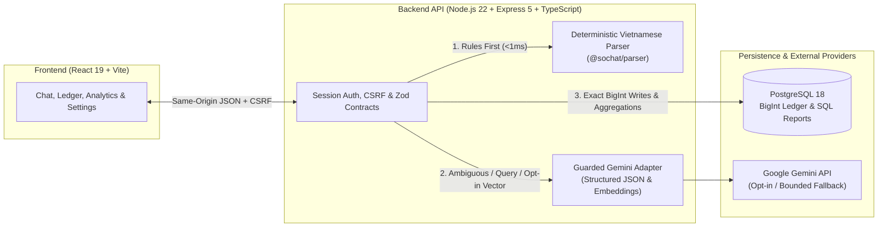

# SổChat — Vietnamese Chat-to-Ledger Personal Finance Tracker

[](https://github.com/Krezzy88/sochat/actions/workflows/ci.yml)
[](.node-version)
[](tsconfig.json)
[](db/README.md)
[](LICENSE)

**SổChat** is a full-stack Vietnamese expense tracker that turns natural chat messages (e.g., _"trưa ăn phở 50k, gửi xe 5k"_) into structured, auditable ledger entries through an explicit **Draft-First Confirmation** workflow.

[**Live Demo**](https://sochat.onrender.com) · [**Architecture & API**](docs/API.md) · [**OpenAPI 3.1 Spec**](apps/api/openapi.json) · [**Verification Evidence**](docs/EVIDENCE.md) · [**1.0 Release Plan**](docs/release/V1_PLAN.md)

> **Engineering Transparency Note:** The 1.0 upgrade is maintained in this repository; the public demo may run a prior deployment snapshot. Hosted database restore rehearsal remains pending, and evaluation scores on the 50-case owner dev split are not claimed as held-out generalization metrics. See [Verification Evidence](docs/EVIDENCE.md) for measured scopes and limitations.

---

## Key Capabilities

- **Chat-to-Ledger Extraction with Draft Confirmation:** Enter natural Vietnamese messages with colloquial shorthand (`k`, `ngàn`, `lít`, `củ`, `tr`). Deterministic rules and guarded Gemini structured extraction propose line items; nothing is written to the database until you review, edit, or confirm the draft.
- **Conversational Draft Revision:** Refine multi-item drafts in plain Vietnamese (e.g., _"tăng khoản 1 thêm 20k"_) before saving.
- **Natural-Language Ledger Assistant ("Hỏi cuốn sổ"):** Ask questions about spending, income, category breakdowns, or month-over-month comparisons and receive deterministic SQL-backed answers accompanied by verifiable source transactions.
- **Opt-In Semantic & Hybrid Search:** Search transaction notes by meaning (e.g., _"đồ uống buổi sáng"_ matching _"cà phê sữa"_) using Gemini embeddings (`768`-dim cosine similarity blended with lexical token overlap). Disabled by default behind explicit user privacy consent.
- **Full Financial Workspace:** Interactive ledger filtering and manual entry, monthly/yearly analytics with accessible HTML table equivalents, category budgets, savings goals with contribution history, UTF-8 CSV export, and self-service account/data deletion.

|                   Chat Extraction & AI Ledger Assistant                   |                 Monthly Analytics & Budget Dashboard                  |
| :-----------------------------------------------------------------------: | :-------------------------------------------------------------------: |
|  |  |

---

## Neuro-Symbolic AI Boundary: What AI Does vs. What Code/SQL Does

SổChat is architected around a strict separation between **probabilistic language understanding** and **deterministic financial accounting**:

- **What Gemini Does:** Extracts structured transaction fields, interprets natural-language draft edits, maps user questions into typed query filters (`responseJsonSchema`), and generates embeddings only when explicitly consented.
- **What Gemini Never Does:** AI **never** generates SQL, **never** computes monetary totals or balances, and **never** writes directly to the ledger.
- **What Code & PostgreSQL 18 Do:** Enforce exact integer VND (`BigInt` / PostgreSQL `bigint`), session authorization, parameterized SQL aggregations, period comparisons, and explicit confirmation writes.
- **Graceful Degradation:** When the AI provider is unavailable or unconfigured, deterministic Vietnamese rules continue parsing clear messages and the UI provides full manual entry/editing without fabricating fallback data.



---

## Technical Highlights

- **Zero Floating-Point Money Drift:** Every monetary value is normalized to integer VND (`BigInt` in TypeScript, `bigint` in PostgreSQL 18, and string-serialized integer VND across JSON/OpenAPI boundaries).
- **Contract-First API & Security Hygiene:**
  - Express 5 + Zod validation schemas automatically compiled into a verified [OpenAPI 3.1 contract](apps/api/openapi.json).
  - Argon2id password hashing, `HttpOnly` + `SameSite=Lax` PostgreSQL-backed sessions, double-submit CSRF protection, rate limiting, and structured log field redaction.
  - Explicit opt-in privacy toggle (`PUT /api/settings/privacy`) required before any transaction note is sent for embedding; disabling immediately purges stored embeddings.
- **Multi-Layer Verification Pipeline:**
  - **Unit & Property Tests:** Deterministic Vietnamese parser, money input normalization, and evaluation harness (`Vitest` + `fast-check`).
  - **Isolated Database Integration Suite:** 100+ HTTP/DB/AI contract tests running against ephemeral `PostgreSQL 18` containers via `Testcontainers`.
  - **Cross-Browser End-to-End & Accessibility Checks:** Full desktop and mobile user journeys verified in `Playwright` (Chromium + WebKit) and audited with `Lighthouse`.
  - **DevSecOps:** Multi-stage non-root Docker builds, Compose smoke tests, tracked-file secret checks, and `Trivy` vulnerability/secret/misconfiguration scans in GitHub Actions.

---

## Quick Start

### 1. Zero-Config Container Demo (Docker Compose)

Run the entire stack locally in isolated non-root containers using PostgreSQL 18 and the deterministic `FakeProvider` (no Gemini API key required):

```sh
docker compose --env-file /dev/null up --build --wait
# Open http://localhost:8080 (register with synthetic test data only)
docker compose --env-file /dev/null down
```

### 2. Local Native Development

Requires **Node.js 22.23.4** (`.node-version`), **npm 10**, and **PostgreSQL 18**. Never commit API keys or secrets to Git.

```sh
npm ci
cp .env.example .env
# Configure local database and session secrets in .env, then run:
npm run db:migrate
npm run api:start
# In a second terminal:
npm run web:dev
```

See [Deployment Guide](docs/DEPLOYMENT.md) · [Vietnamese Parser Contract](docs/PARSER.md) · [AI Evaluation Harness](eval/README.md) · [Operations Runbook](docs/RUNBOOK.md).

---

## Verification & Quality Gates

```sh
npm run typecheck        # Workspace-wide TypeScript strict check
npm run lint             # ESLint + Prettier formatting verification
npm test                 # Unit & property-based test suite
npm run test:coverage    # Unit suite with V8 coverage thresholds
npm run test:integration # Ephemeral PostgreSQL 18 integration suite (requires Docker)
npm run e2e              # Full-stack Playwright Chromium E2E suite (desktop & mobile)
npm run api:openapi      # Regenerate and validate OpenAPI 3.1 specification
```

- **Deterministic CI vs. Live Gemini Evaluation:** GitHub Actions runs deterministic providers to verify contracts reliably on every push and pull request; live Gemini evaluation is recorded separately via `npm run eval:llm` and `npm run check:gemini:live`.
- **Evaluation & Benchmark Discipline:** The 50 owner dev prompts were used iteratively during rule/prompt refinement and do not replace an independent held-out evaluation split. The 1-million-row PostgreSQL benchmark and exact measurement boundaries are documented in [Verification Evidence](docs/EVIDENCE.md).

---

## Repository Layout

| Directory                 | Purpose                                                                         |
| ------------------------- | ------------------------------------------------------------------------------- |
| `apps/api/`               | Express 5 + TypeScript backend API, PostgreSQL 18 repositories, Gemini adapters |
| `apps/web/`               | React 19 + Vite single-page workspace (Chat, Ledger, Dashboard, Budgets, Goals) |
| `packages/parser/`        | Pure deterministic Vietnamese transaction parser (`@sochat/parser`)             |
| `config/testing/`, `e2e/` | Vitest, Playwright (Chromium/WebKit/Compose/Release), and Lighthouse configs    |
| `db/`                     | SQL migrations, seed fixtures, and 1M-row benchmark tooling                     |
| `docker/`                 | Multi-stage production Dockerfiles and Nginx reverse-proxy configuration        |
| `scripts/`                | Runtime guards, secret scanners, restore rehearsal, and evaluation utilities    |
| `docs/`                   | [Documentation index](docs/README.md), architecture decisions, and evidence     |
| `eval/`                   | Extraction evaluation runner, synthetic datasets, and recorded metrics          |
| `.local/`                 | Git-ignored private owner files and local backups (never used in deployment)    |

`npm run clean` removes generated build and test artifacts while preserving local credentials, dependencies, recorded evidence, and private backups.

---

## Scope & License

- **Stack:** React 19 + Vite, Express 5 + TypeScript, PostgreSQL 18, Google Gemini API; deployed as a unified same-origin Web/API service.
- **Explicit Non-Goals:** Bank account syncing, receipt OCR, multi-currency conversion, and autonomous AI financial advice are intentionally out of scope.
- **History & Attribution:** Developed with AI assistance under strict human architectural gates; full chronological records are preserved in [README History](docs/archive/README_HISTORY.md) and [Architecture Decisions](docs/DECISIONS.md).
- **License:** [MIT](LICENSE).
