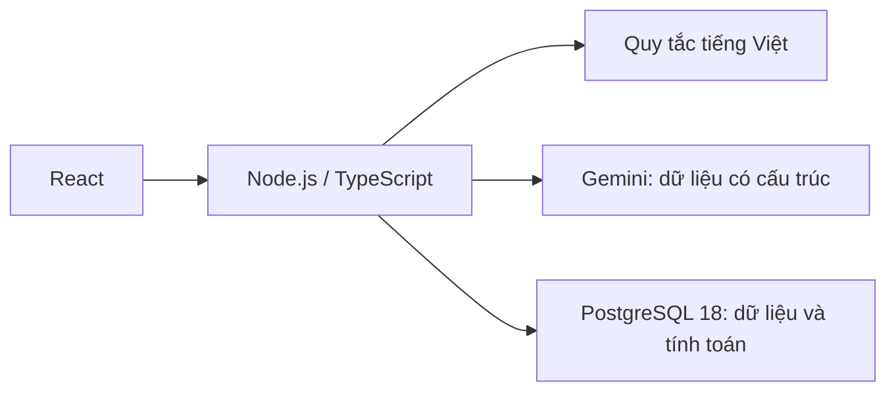

# SổChat

Ghi thu chi bằng tin nhắn tiếng Việt, kiểm tra trước khi lưu và xem báo cáo từ dữ liệu của bạn.

[Ứng dụng đang chạy](https://sochat.onrender.com) · [Kiến trúc và API](docs/API.md) · [Bằng chứng kiểm tra](docs/EVIDENCE.md) · [Kế hoạch 1.0](docs/release/V1_PLAN.md)

> Bản nâng cấp 1.0 đang được hoàn thiện trong repository; link đang chạy có thể dùng phiên bản trước. Chưa xác nhận khả năng khôi phục database hosted. Không công bố độ chính xác trên người dùng mới khi chưa đánh giá held-out.

## Trải nghiệm chính

- Nhập “trưa ăn phở 50k”: quy tắc và Gemini đề xuất khoản ghi, bạn kiểm tra/sửa rồi xác nhận.
- Tìm, lọc, sửa và xóa giao dịch; báo cáo tháng/năm, ngân sách và quỹ mục tiêu.
- Hỏi thu chi và so sánh hai tháng, có giao dịch để kiểm chứng.
- Xuất CSV, xóa tài khoản và đổi mật khẩu kèm thu hồi phiên đăng nhập.
- Google login, xác minh email và khôi phục mật khẩu đã có code; cần [cấu hình nhà cung cấp](docs/release/AUTH_SETUP.md) trước khi bật.
- Tìm theo ý nghĩa là tùy chọn, mặc định tắt và cần đồng ý gửi ghi chú đến Gemini.


## AI làm gì?

Gemini bóc tách dữ liệu, hiểu bộ lọc câu hỏi và tạo embedding khi được cho phép.
AI không tạo SQL, không tính tổng tiền và không tự ghi giao dịch.
Code/SQL xử lý số nguyên VND, phân quyền, tính toán và xác nhận lưu.
Khi AI không phản hồi, người dùng cần có đường nhập/sửa thủ công; không thay kết quả bằng dữ liệu giả.



## Chạy local

Cần Node.js 22.23.4, npm 10 và PostgreSQL 18. Không đưa khóa hoặc mật khẩu vào Git.

```sh
npm ci
cp .env.example .env
# Điền cấu hình local trong .env, rồi:
npm run db:migrate
npm run api:start
# Terminal khác:
npm run web:dev
```

[Hướng dẫn triển khai](docs/DEPLOYMENT.md) · [Quy tắc parser](docs/PARSER.md) · [Đánh giá AI](eval/README.md)

## Kiểm chứng

```sh
npm run typecheck
npm run lint
npm test
npm run test:integration # Docker, PostgreSQL tạm riêng
npm run e2e             # Chromium + Docker, desktop/mobile
```

CI dùng phản hồi xác định để kiểm tra hợp đồng; kiểm tra Gemini thật được ghi riêng.
50 câu owner dev đã được dùng để cải tiến: kết quả không thay thế tập held-out độc lập.
Benchmark 1 triệu dòng và phạm vi từng phép đo có trong EVIDENCE; không suy ra độ trễ toàn ứng dụng từ thời gian một truy vấn.

## Phạm vi và phát triển

React + Vite, Express + TypeScript, PostgreSQL 18, Gemini; triển khai Web/API chung origin.
Không OCR, liên kết ngân hàng, nhiều tiền tệ hoặc tư vấn tài chính AI.
Dự án được phát triển với hỗ trợ AI; quyết định kỹ thuật và kết quả kiểm tra được lưu trong repository.

[Lịch sử tài liệu và các phase](docs/release/README_HISTORY.md). Giấy phép [MIT](LICENSE).
